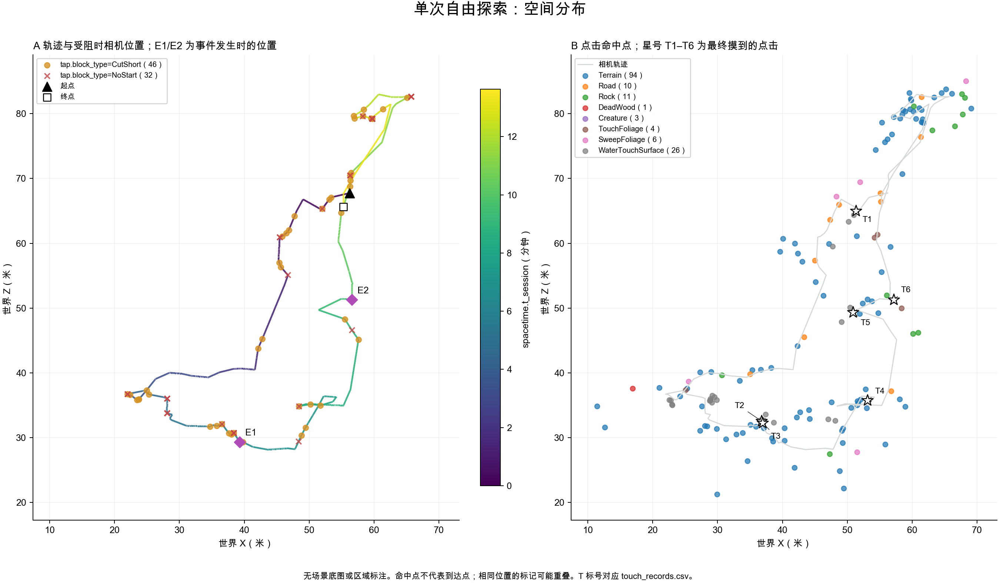
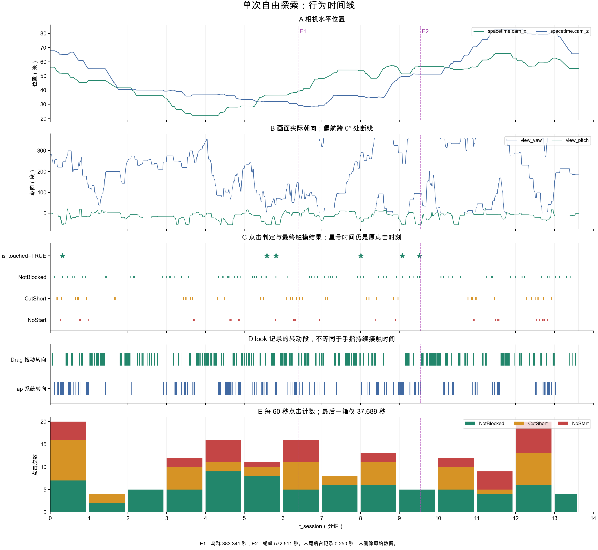
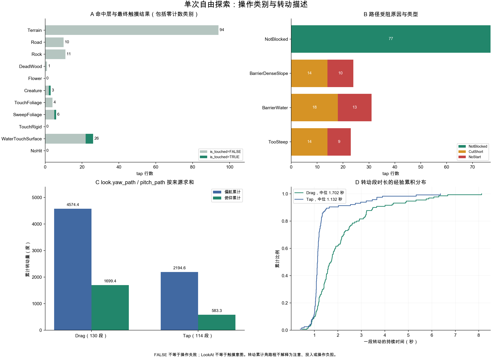

# 单次自由探索的独立描述

本报告描述研究者在编辑器中的开发测试，不能代表正式被试或两组效果。数据为 sub-P999_ses-S001_mod-Interactive_run-002。第一段未读取既有 describe.py、summary.json 或三张旧图；也未开展第二段对照。描述依据先写在 description_plan.md。

## 记录范围与可用性

session.t_device_end − session.t_device_start = **817.689 秒（13.628 分钟）**，有正常结束时间。spacetime.t_session 覆盖 0.028–817.601 秒，首尾分别与会话边界相差 0.028、0.088 秒。

| table | rows |
| --- | --- |
| session | 1 |
| spacetime | 8177 |
| tap | 155 |
| backstep | 1 |
| look | 244 |
| world_event | 4 |
| tech_glitch | 1 |

spacetime 相邻采样间隔中位数 0.100 秒，95% 分位 0.113 秒，最大 0.168 秒。各表记录时间递增；look 的开始不晚于结束，转动段之间没有重叠。除 Fired 行不适用的 world_event.detail 两个空值外，本次七表没有空单元格。

tech_glitch 只有末尾一行：t_session=817.419、status=Background、duration=0.250 秒；未记录 Freeze。这不代表编辑器全过程绝对没有卡顿，只表示正式实验表在其记录时段内没有 Freeze 行。保留原始记录，不据此整体排除会话。

历史字符串 None 在分析副本中映射为 NoHit 或 NotBlocked，原始文件未修改。本次 tap.intent、tap.hit_layer 没有 None/NoHit；tap.block_type 和 tap.block_reason 各有 77 个 None，backstep 两列各有 1 个。此映射不是缺失值填补。

三张操作表合并观察到 touch_id 1–252，没有缺号。tap 有 155 个不同序号；Drag 的 130 段对应 97 个序号；backstep 的序号 139 同时关联 Drag。因此表的行数不能直接相加当触屏次数，look 的段数也不是拖动次数。所有 Tap 类型转动都能找到对应 tap.touch_id。

spacetime 和 tap 的 t_device − t_session − session.t_device_start 大致在 −0.001 至 0.022 秒内；其余事件表按会话起点换算，为零。此处只核对本文件内的时钟一致性，没有手机/LSL 数据，不能检验跨设备同步。

## 实际接触了什么

155 次点击中，tap.intent 为 WalkTo 72 次、LookAt 83 次；均有命中，没有 NoHit。LookAt 是系统判定类别，不能逐次解读为被试明确想触摸。命中 Terrain/Road 共 104 次；其他层共 51 次。命中与最终触摸结果如下：

| hit_layer | is_touched_FALSE | is_touched_TRUE | tap_n |
| --- | --- | --- | --- |
| Terrain | 94 | 0 | 94 |
| Road | 10 | 0 | 10 |
| Rock | 11 | 0 | 11 |
| DeadWood | 1 | 0 | 1 |
| Flower | 0 | 0 | 0 |
| Creature | 2 | 1 | 3 |
| TouchFoliage | 4 | 0 | 4 |
| SweepFoliage | 5 | 1 | 6 |
| TouchRigid | 0 | 0 | 0 |
| WaterTouchSurface | 22 | 4 | 26 |
| NoHit | 0 | 0 | 0 |

**tap.is_touched=TRUE 共 6 次：WaterTouchSurface 4 次、SweepFoliage 1 次、Creature 1 次。** TouchFoliage 命中 4 次，均未记录最终摸到；TouchRigid 没有命中。149 次 FALSE 包含大量导航、走近观察等点击，不能当成 149 次触摸失败，也不将 6/155 称作触摸成功率。

| touch_label | touch_id | t_session | hit_layer | cam_x | cam_z | hit_x | hit_z |
| --- | --- | --- | --- | --- | --- | --- | --- |
| T1 | 7 | 18.702 | WaterTouchSurface | 51.880 | 65.190 | 51.310 | 64.970 |
| T2 | 102 | 334.958 | WaterTouchSurface | 36.530 | 32.130 | 36.790 | 32.550 |
| T3 | 105 | 349.095 | WaterTouchSurface | 36.530 | 32.130 | 36.970 | 32.270 |
| T4 | 148 | 480.293 | SweepFoliage | 53.670 | 35.550 | 53.100 | 35.780 |
| T5 | 168 | 544.283 | WaterTouchSurface | 51.440 | 49.700 | 50.890 | 49.340 |
| T6 | 176 | 571.075 | Creature | 56.580 | 51.290 | 57.140 | 51.320 |

表中 t_session 是原点击判定时刻，非补发出手时间。第一次最终摸到的关联点击为 18.702 秒；之后依次为 334.958、349.095、480.293、544.283、571.075 秒。这些记录证明系统执行了触摸，不证明注意或喜爱程度。

world_event 记录两个 Fired 和两个 NotFired：

| t_session | event_name | action | detail |
| --- | --- | --- | --- |
| 383.341 | ScriptedEvent_bird_r3-r2 | Fired |  |
| 572.511 | ScriptedEvent_R1-2_butterfly | Fired |  |
| 817.667 | ScriptedEvent_R1_east_butterfly | NotFired | NeverEntered |
| 817.668 | ScriptedEvent_bird_r1-r2 | NotFired | NoSight |

383.341 秒鸟群事件发生，572.511 秒手触发蝴蝶事件发生。另一只蝴蝶的触发者未进入范围（NeverEntered）；另一组鸟虽进入过触发范围，但视线条件未满足（NoSight）。这些是系统触发结论；NoSight 不等于“被试从未看见鸟所在方向”。HandStartle 行为零，但这不能解释为没有惊飞蝴蝶：手触发的剧本蝴蝶在本次记作 Fired，HandStartle 对应的是常驻停落生物。

## 接触发生在怎样的操作过程中

tap.block_type 有 NotBlocked 77 次、CutShort 46 次、NoStart 32 次。受路径限制的点击共 **78/155（50.3%）**。CutShort 表示有一部分路径获准，不能与 NoStart 混为“完全失败”；按设计停在目标前方也不算路径受阻。

| block_reason | NotBlocked | CutShort | NoStart |
| --- | --- | --- | --- |
| NotBlocked | 77 | 0 | 0 |
| BarrierDenseSlope | 0 | 14 | 10 |
| BarrierWater | 0 | 18 | 13 |
| TooSteep | 0 | 14 | 9 |

三类实际出现的受阻原因是 BarrierWater 31 次、BarrierDenseSlope 24 次、TooSteep 23 次。WalkTo 与 LookAt 都出现受阻：

| intent | NotBlocked | CutShort | NoStart |
| --- | --- | --- | --- |
| NoHit | 0 | 0 | 0 |
| WalkTo | 41 | 20 | 11 |
| LookAt | 36 | 26 | 21 |

受阻并非只在开头出现：0–60 秒为 13/20 次，360–420 秒为 11/16 次，720–780 秒为 14/20 次。这里只描述这些时间窗的记录，不据此认定是在学习、找路或挫败。图 1A 显示的是受阻点击发生时的相机位置，不是墙体或路径阻断点。

look 记录了 Drag 130 段和 Tap 114 段，前者包含拖动后的惯性，后者包含点击驱动的身体转向、俯仰跟随等。它们应分开描述：

| look_type | segments_n | distinct_touch_ids_n | duration_sum_s | duration_median_s | duration_min_s | duration_max_s | yaw_path_sum_deg | pitch_path_sum_deg |
| --- | --- | --- | --- | --- | --- | --- | --- | --- |
| Drag | 130 | 97 | 275.636 | 1.702 | 0.494 | 8.119 | 4574.400 | 1699.400 |
| Tap | 114 | 113 | 154.516 | 1.132 | 0.400 | 6.370 | 2194.600 | 583.300 |

持续时间按 look.t_session_end − look.t_session_start 求和；角路程直接累计 look.yaw_path/pitch_path。累计角路程不能当作净转圈数或努力程度。记录器的分段和停稳机制使“起止朝向相减”与已记录净量可有小差异；本次偏航最大 0.3°、俯仰最大 0.4°，未擅自用端点覆盖原列，也未将这些差值等同于新的行为。

backstep 仅一条：touch_id=139，t_session=438.854 秒，back_dist=1.00 米，未受阻。距离是 backstep.back_dist 的原始值，不用轨迹重建后冒充该字段。

## 时间与空间分布

相邻 spacetime.cam_x/cam_z 采样点连接的水平折线长约 **211.39 米**，不包含相机俯仰或蹲起造成的竖直变化，不代表体力消耗或精确步行里程。与技术异常重叠的采样段为 3 段，剔除这些段后的水平折线长仍为 211.39 米。

图 1 与图 2 显示，前段向较小 X/Z 的方向推进，中段沿较低 Z 的位置向较大 X 返回，后段又走到较大 Z 的位置，最后回到起点附近。这是对路线形状的描述，不是对探索意图的判断。

轨迹起点为 X/Z=56.23/67.75 米，终点为 55.27/65.62 米，二者相距 2.34 米。cam_x 范围 22.01–65.73 米，cam_z 为 28.17–82.97 米，ground_y 为 0.75–4.85 米。图中保留空间关系；这些范围不用于计算场地覆盖率。没有区域多边形或景点圆，未推定访问了哪些区域、景点，也未把返回附近解释为迷路。

固定 60 秒分箱仅用于展示原始事件分布。最后一箱为 780–817.689 秒，只有 37.689 秒，不能把其 4 次点击当作完整一分钟的次数作直接比较。

| bin | start_s | end_s | observed_s | tap_n | is_touched_TRUE_n | NotBlocked_n | CutShort_n | NoStart_n |
| --- | --- | --- | --- | --- | --- | --- | --- | --- |
| 1 | 0.000 | 60.000 | 60.000 | 20 | 1 | 7 | 9 | 4 |
| 2 | 60.000 | 120.000 | 60.000 | 4 | 0 | 2 | 2 | 0 |
| 3 | 120.000 | 180.000 | 60.000 | 5 | 0 | 5 | 0 | 0 |
| 4 | 180.000 | 240.000 | 60.000 | 12 | 0 | 5 | 5 | 2 |
| 5 | 240.000 | 300.000 | 60.000 | 16 | 0 | 9 | 2 | 5 |
| 6 | 300.000 | 360.000 | 60.000 | 11 | 2 | 8 | 2 | 1 |
| 7 | 360.000 | 420.000 | 60.000 | 16 | 0 | 5 | 6 | 5 |
| 8 | 420.000 | 480.000 | 60.000 | 8 | 0 | 6 | 2 | 0 |
| 9 | 480.000 | 540.000 | 60.000 | 13 | 1 | 6 | 5 | 2 |
| 10 | 540.000 | 600.000 | 60.000 | 5 | 2 | 5 | 0 | 0 |
| 11 | 600.000 | 660.000 | 60.000 | 12 | 0 | 5 | 5 | 2 |
| 12 | 660.000 | 720.000 | 60.000 | 9 | 0 | 4 | 1 | 4 |
| 13 | 720.000 | 780.000 | 60.000 | 20 | 0 | 6 | 7 | 7 |
| 14 | 780.000 | 817.689 | 37.689 | 4 | 0 | 4 | 0 | 0 |

## 调试日志核对与解释边界

指定 Tap 调试日志有 258 行，其中 155 行为走过去/我想看，命中层、相机位置和命中位置逐行与 tap 表吻合；六条实际触碰也按命中层和三维命中位置对应一致。五条触碰在调试表中另写为补发出手，因此不能把调试行号直接当作 touch_id，或只看原点击调试行判断是否触碰。

四条世界事件的事件名、发生/未发生结论和相机位置均与 Event 调试表对应。Event 的 source 表明 bird_r3-r2 由 Observer 触发、R1-2_butterfly 由 Hand 触发。鸟群 path-end 的调试 detail 另记画面内可见 13.2 秒；这是调试可见性估计，不在 world_event 中，不能写成已测得“注意了 13.2 秒”，也不纳入本次正式表摘要。

Sound 在启动附近有两条 hitch，在退出附近有一条 focus-lost；tech_glitch 在末尾记 Background。调试表使用旧游戏时钟，时间值约比 t_session 大 100.2 秒，且并非严格固定偏移，不能直接按同名时间或固定常数强行连接，也不能将启动调试 hitch 搬成正式会话里的 Freeze。

本次最清楚的事实是：接近 13.6 分钟内有较长的空间移动和多段主动拖动转向，最终触摸只有六次，两个剧本事件发生；路径限制在多个时段出现。行为不能单独解释兴趣、无聊、注意、迷路或挫败，也不能证明某种场景设计优劣。研究者自由测试的目的与正式被试不同，本报告不做总体推断，不设计指标。

## 复现与文件

describe.py 通过 lib.paths 定位、lib.app_io 读取七张实验表。summary.json 保存完整数字、映射、检查和原始文件 SHA-256；debug_verification.json 保存核对口径。table_layers.csv、table_block_reasons.csv、table_intent_blocks.csv、table_look.csv、table_time_bins.csv、touch_records.csv、world_events.csv 是本次描述的辅助明细。所有原始文件在运行前后核对 SHA-256，不修改规范、共用读取库或旧描述。

运行：在本目录执行 python3 describe.py --debug-log-root <Unity 的 Interaction/Logs~ 目录>。脚本要求同时核对指定调试日志。脚本只生成本目录列出的描述文件，不读取父目录其他描述。运行环境详见 summary.json。
