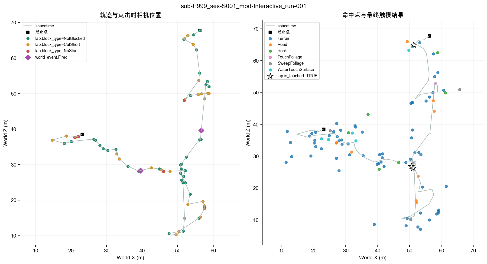
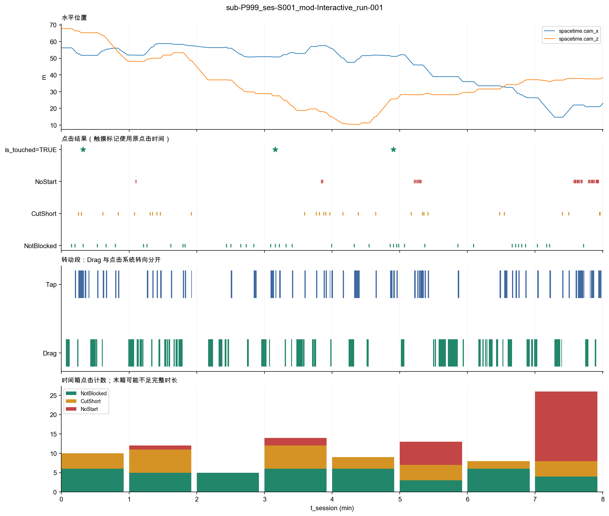
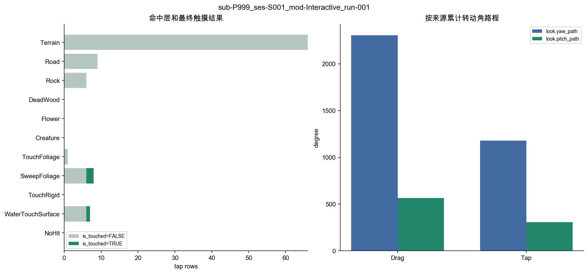

# 埋点数据描述

sub-P999_ses-S001_mod-Interactive_run-001

## 原理与方法

本报告描述记录到的环境接触与操作过程。先交代可用数据，再呈现触摸、世界事件、受阻、转动以及时间和空间分布。行为事实不直接解释为兴趣、注意、无聊或动机。

数据由根目录 run.py 调度：01 核对文件，02 在副本中处理已定的历史取值，03 统一类型，06 从标准表生成描述。字段、方法、参数与路径均来自 settings.py；未定义新的行为指标。

## 记录范围与可用性

session.t_device_end − session.t_device_start = 480.391 秒。缺失文件的行数显示为空，不按零次行为解释。

| table | present | rows | applicable |
| --- | --- | --- | --- |
| session | True | 1 | True |
| spacetime | True | 4804 | True |
| tap | True | 97 | True |
| backstep | True | 1 | True |
| look | True | 134 | True |
| world_event | True | 4 | True |
| tech_glitch | True | 1 | True |

## 操作与实际接触

tap 行数为 97；tap.is_touched=TRUE 为 3；tap.block_type 为 CutShort/NoStart 的行数合计 56。未触摸不等于操作失败，LookAt 也不等于明确的触摸意图。

| hit_layer | tap_n | is_touched_TRUE_n | is_touched_FALSE_n | is_touched_missing_n |
| --- | --- | --- | --- | --- |
| Terrain | 66 | 0 | 66 | 0 |
| Road | 9 | 0 | 9 | 0 |
| Rock | 6 | 0 | 6 | 0 |
| DeadWood | 0 | 0 | 0 | 0 |
| Flower | 0 | 0 | 0 | 0 |
| Creature | 0 | 0 | 0 | 0 |
| TouchFoliage | 1 | 0 | 1 | 0 |
| SweepFoliage | 8 | 2 | 6 | 0 |
| TouchRigid | 0 | 0 | 0 | 0 |
| WaterTouchSurface | 7 | 1 | 6 | 0 |
| NoHit | 0 | 0 | 0 | 0 |

下列类别计数由 summary.json 保存；历史 None 已按配置分别映射为 NoHit/NotBlocked。

| field | level | rows |
| --- | --- | --- |
| tap.intent | NoHit | 0 |
| tap.intent | WalkTo | 44 |
| tap.intent | LookAt | 53 |

| field | level | rows |
| --- | --- | --- |
| tap.block_type | NotBlocked | 41 |
| tap.block_type | CutShort | 29 |
| tap.block_type | NoStart | 27 |

| field | level | rows |
| --- | --- | --- |
| tap.block_reason | NotBlocked | 41 |
| tap.block_reason | BarrierDenseSlope | 33 |
| tap.block_reason | BarrierWater | 11 |
| tap.block_reason | BarrierUnlabeled | 0 |
| tap.block_reason | StepUp | 0 |
| tap.block_reason | DropTooHigh | 0 |
| tap.block_reason | TooSteep | 12 |
| tap.block_reason | NoGround | 0 |

## 转动、后退与世界事件

| look_type | segments_n | touch_ids_n | duration_sum_s | duration_median_s | yaw_path_sum_deg | pitch_path_sum_deg |
| --- | --- | --- | --- | --- | --- | --- |
| Drag | 64 | 53 | 125.329 | 1.484 | 2305.400 | 564.700 |
| Tap | 70 | 68 | 84.742 | 1.121 | 1179.100 | 306.400 |

转动段数与触屏次数分开，Drag 包含惯性；Tap 是系统响应。累计角路程不代表净转圈数或操作负担。

### backstep

| touch_id | t_session | t_device | cam_x | cam_y | cam_z | back_dist | block_type | block_reason |
| --- | --- | --- | --- | --- | --- | --- | --- | --- |
| 40 | 144.010 | 1792722510.072 | 56.380 | 3.690 | 37.040 | 1.000 | NotBlocked | NotBlocked |

### world_event

| t_session | t_device | event_name | action | cam_x | cam_y | cam_z | detail |
| --- | --- | --- | --- | --- | --- | --- | --- |
| 126.735 | 1792722492.786 | ScriptedEvent_bird_r1-r2 | Fired | 56.630 | 3.810 | 39.650 | — |
| 328.845 | 1792722694.896 | ScriptedEvent_bird_r3-r2 | Fired | 39.530 | 4.120 | 28.320 | — |
| 480.379 | 1792722846.430 | ScriptedEvent_R1-2_butterfly | NotFired | 23.140 | 7.330 | 38.510 | NeverEntered |
| 480.380 | 1792722846.431 | ScriptedEvent_R1_east_butterfly | NotFired | 23.140 | 7.330 | 38.510 | NeverEntered |

### tech_glitch

| t_session | t_device | status | duration |
| --- | --- | --- | --- |
| 480.200 | 1792722846.251 | Background | 0.180 |

## 时间与空间

按相邻 spacetime.cam_x/cam_z 连线求和的水平折线长为 168.57 米。这是采样近似，未做平滑或插补，不解释为体力消耗、停留或覆盖率。命中点不是到达点。

时间箱宽度设置为 60 秒，每箱实际 observed_s 单独列出。

| start_s | end_s | observed_s | tap_n | is_touched_TRUE_n | NotBlocked | CutShort | NoStart |
| --- | --- | --- | --- | --- | --- | --- | --- |
| 0.000 | 60.000 | 60.000 | 10 | 1 | 6 | 4 | 0 |
| 60.000 | 120.000 | 60.000 | 12 | 0 | 5 | 6 | 1 |
| 120.000 | 180.000 | 60.000 | 5 | 0 | 5 | 0 | 0 |
| 180.000 | 240.000 | 60.000 | 14 | 1 | 6 | 6 | 2 |
| 240.000 | 300.000 | 60.000 | 9 | 1 | 6 | 3 | 0 |
| 300.000 | 360.000 | 60.000 | 13 | 0 | 3 | 4 | 6 |
| 360.000 | 420.000 | 60.000 | 8 | 0 | 6 | 2 | 0 |
| 420.000 | 480.000 | 60.000 | 26 | 0 | 4 | 4 | 18 |
| 480.000 | 480.391 | 0.391 | 0 | 0 | 0 | 0 | 0 |

## 数据检查

技术异常保留在原始时段中；本轮不执行被试排除或行为分类。world_event 的 Fired 不证明注意，HandStartle 只对应常驻停落生物，不能覆盖所有手触发剧本事件。

未发现文件缺失或时间顺序警告；这不等于已检验全部研究数据质量。

## 复现

本次运行的根目录含 manifest.json 与 settings_snapshot.json，可核对输入 SHA-256、脚本 SHA-256、选择范围与配置。原始数据不改写，文字与图表由同次计算生成。
