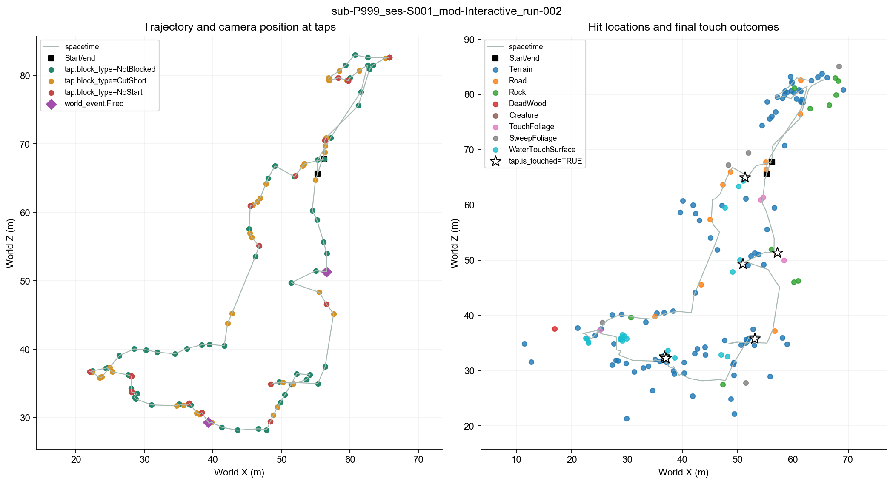
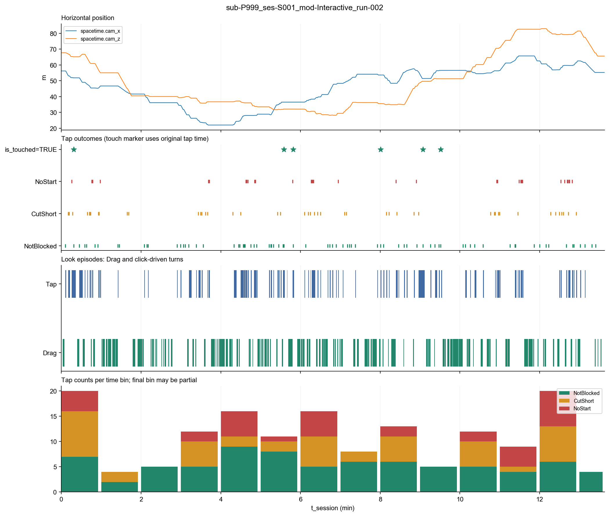
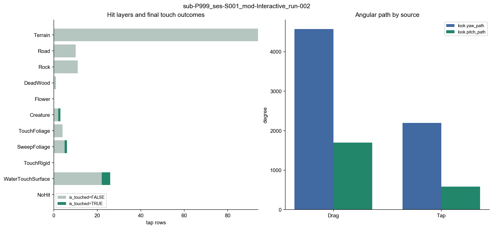

# APP log description

sub-P999_ses-S001_mod-Interactive_run-002

## Purpose and methods

This report describes recorded environmental contact and interaction. It first establishes data availability, then summarizes touches, world events, path restrictions, turns, and temporal and spatial distributions. Behavior alone does not establish interest, attention, boredom or motivation.

The root runner executes inventory, configured legacy-value cleaning, type formatting and description. Columns, methods, parameters and paths come from settings.py. No new behavioral metric is defined.

## Recording scope and availability

session.t_device_end − session.t_device_start = 817.689 seconds. Missing-file counts are unavailable, rather than zero.

| table | present | rows | applicable |
| --- | --- | --- | --- |
| session | True | 1 | True |
| spacetime | True | 8177 | True |
| tap | True | 155 | True |
| backstep | True | 1 | True |
| look | True | 244 | True |
| world_event | True | 4 | True |
| tech_glitch | True | 1 | True |

## Actions and recorded contact

tap rows: 155; tap.is_touched=TRUE: 6; rows with tap.block_type CutShort/NoStart: 78. A non-touch is not necessarily a failed action, and LookAt does not establish an intention to touch.

| hit_layer | tap_n | is_touched_TRUE_n | is_touched_FALSE_n | is_touched_missing_n |
| --- | --- | --- | --- | --- |
| Terrain | 94 | 0 | 94 | 0 |
| Road | 10 | 0 | 10 | 0 |
| Rock | 11 | 0 | 11 | 0 |
| DeadWood | 1 | 0 | 1 | 0 |
| Flower | 0 | 0 | 0 | 0 |
| Creature | 3 | 1 | 2 | 0 |
| TouchFoliage | 4 | 0 | 4 | 0 |
| SweepFoliage | 6 | 1 | 5 | 0 |
| TouchRigid | 0 | 0 | 0 | 0 |
| WaterTouchSurface | 26 | 4 | 22 | 0 |
| NoHit | 0 | 0 | 0 | 0 |

The following category counts are stored in summary.json. Legacy None values are mapped to NoHit/NotBlocked only in configured fields.

| field | level | rows |
| --- | --- | --- |
| tap.intent | NoHit | 0 |
| tap.intent | WalkTo | 72 |
| tap.intent | LookAt | 83 |

| field | level | rows |
| --- | --- | --- |
| tap.block_type | NotBlocked | 77 |
| tap.block_type | CutShort | 46 |
| tap.block_type | NoStart | 32 |

| field | level | rows |
| --- | --- | --- |
| tap.block_reason | NotBlocked | 77 |
| tap.block_reason | BarrierDenseSlope | 24 |
| tap.block_reason | BarrierWater | 31 |
| tap.block_reason | BarrierUnlabeled | 0 |
| tap.block_reason | StepUp | 0 |
| tap.block_reason | DropTooHigh | 0 |
| tap.block_reason | TooSteep | 23 |
| tap.block_reason | NoGround | 0 |

## Turns, backsteps and world events

| look_type | segments_n | touch_ids_n | duration_sum_s | duration_median_s | yaw_path_sum_deg | pitch_path_sum_deg |
| --- | --- | --- | --- | --- | --- | --- |
| Drag | 130 | 97 | 275.636 | 1.702 | 4574.400 | 1699.400 |
| Tap | 114 | 113 | 154.516 | 1.132 | 2194.600 | 583.300 |

Look episodes and touch IDs are distinct. Drag includes inertia; Tap is a system response. Angular path is neither net rotations nor operational burden.

### backstep

| touch_id | t_session | t_device | cam_x | cam_y | cam_z | back_dist | block_type | block_reason |
| --- | --- | --- | --- | --- | --- | --- | --- | --- |
| 139 | 438.854 | 1792724183.966 | 52.240 | 3.120 | 36.410 | 1.000 | NotBlocked | NotBlocked |

### world_event

| t_session | t_device | event_name | action | cam_x | cam_y | cam_z | detail |
| --- | --- | --- | --- | --- | --- | --- | --- |
| 383.341 | 1792724128.453 | ScriptedEvent_bird_r3-r2 | Fired | 39.300 | 4.220 | 29.330 | — |
| 572.511 | 1792724317.623 | ScriptedEvent_R1-2_butterfly | Fired | 56.580 | 3.100 | 51.290 | — |
| 817.667 | 1792724562.779 | ScriptedEvent_R1_east_butterfly | NotFired | 55.270 | 4.130 | 65.620 | NeverEntered |
| 817.668 | 1792724562.780 | ScriptedEvent_bird_r1-r2 | NotFired | 55.270 | 4.130 | 65.620 | NoSight |

### tech_glitch

| t_session | t_device | status | duration |
| --- | --- | --- | --- |
| 817.419 | 1792724562.531 | Background | 0.250 |

## Time and space

Horizontal polyline length from consecutive spacetime.cam_x/cam_z samples: 211.39 m. This is a sampling approximation without smoothing or interpolation, not physical effort, dwell or coverage. A hit location is not an arrival location.

Time bins use the configured width; observed_s reports each bin's actual duration.

| start_s | end_s | observed_s | tap_n | is_touched_TRUE_n | NotBlocked | CutShort | NoStart |
| --- | --- | --- | --- | --- | --- | --- | --- |
| 0.000 | 60.000 | 60.000 | 20 | 1 | 7 | 9 | 4 |
| 60.000 | 120.000 | 60.000 | 4 | 0 | 2 | 2 | 0 |
| 120.000 | 180.000 | 60.000 | 5 | 0 | 5 | 0 | 0 |
| 180.000 | 240.000 | 60.000 | 12 | 0 | 5 | 5 | 2 |
| 240.000 | 300.000 | 60.000 | 16 | 0 | 9 | 2 | 5 |
| 300.000 | 360.000 | 60.000 | 11 | 2 | 8 | 2 | 1 |
| 360.000 | 420.000 | 60.000 | 16 | 0 | 5 | 6 | 5 |
| 420.000 | 480.000 | 60.000 | 8 | 0 | 6 | 2 | 0 |
| 480.000 | 540.000 | 60.000 | 13 | 1 | 6 | 5 | 2 |
| 540.000 | 600.000 | 60.000 | 5 | 2 | 5 | 0 | 0 |
| 600.000 | 660.000 | 60.000 | 12 | 0 | 5 | 5 | 2 |
| 660.000 | 720.000 | 60.000 | 9 | 0 | 4 | 1 | 4 |
| 720.000 | 780.000 | 60.000 | 20 | 0 | 6 | 7 | 7 |
| 780.000 | 817.689 | 37.689 | 4 | 0 | 4 | 0 | 0 |

## Data checks

Technical interruptions remain in the recorded timeline; no participant exclusion or behavioral classification is applied. Fired does not establish attention. HandStartle concerns resident perched creatures and does not enumerate all hand-triggered scripted events.

No missing-file or time-order warning; this does not establish full research-data validity.

## Reproduction

The run root contains manifest.json and settings_snapshot.json with input and script SHA-256, selection and configuration. Raw data remain unchanged; text and figures derive from the same computation.
