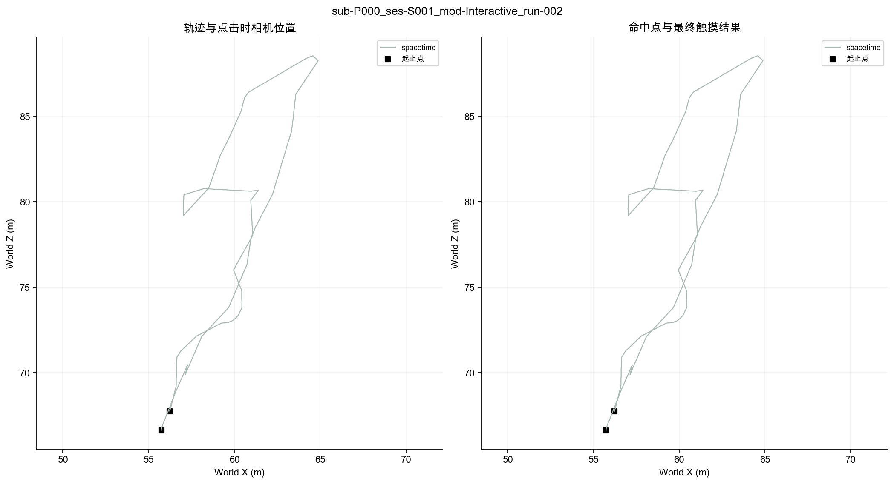
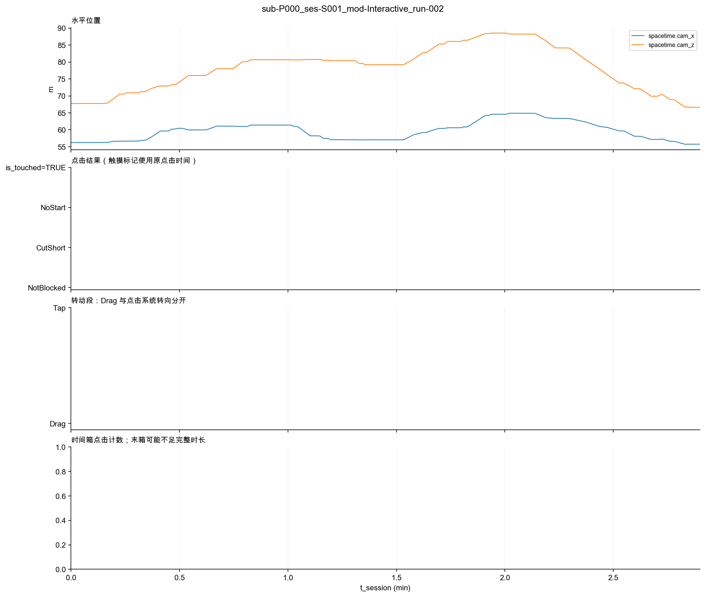
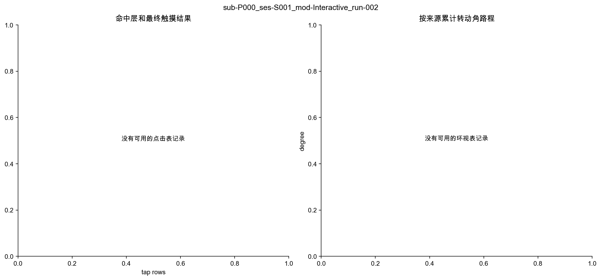

# 埋点数据描述

sub-P000_ses-S001_mod-Interactive_run-002

## 原理与方法

本报告描述记录到的环境接触与操作过程。先交代可用数据，再呈现触摸、世界事件、受阻、转动以及时间和空间分布。行为事实不直接解释为兴趣、注意、无聊或动机。

数据由根目录 02_run.py 调度：01 核对文件，02 在副本中处理已定的历史取值，03 统一类型，06 从标准表生成描述。固定字段、方法与路径来自 00_settings.py，可调参数来自 01_parameters.py；未定义新的行为指标。

## 记录范围与可用性

session.t_device_end − session.t_device_start = 173.925 秒。缺失文件的行数显示为空，不按零次行为解释。

| table | present | rows | applicable |
| --- | --- | --- | --- |
| session | True | 1.000 | True |
| spacetime | True | 1739.000 | True |
| tap | False | — | True |
| backstep | False | — | True |
| look | False | — | True |
| world_event | False | — | True |
| tech_glitch | False | — | True |

## 操作与实际接触

tap 行数为 不可用；tap.is_touched=TRUE 为 不可用；tap.block_type 为 CutShort/NoStart 的行数合计 不可用。未触摸不等于操作失败，LookAt 也不等于明确的触摸意图。

点击数据不可用或无记录。

下列类别计数由 summary.json 保存；历史 None 已按配置分别映射为 NoHit/NotBlocked。

## 转动、后退与世界事件

没有可用的环视记录。

转动段数与触屏次数分开，Drag 包含惯性；Tap 是系统响应。累计角路程不代表净转圈数或操作负担。

### backstep

文件缺失，无法判断次数。

### world_event

文件缺失，无法判断次数。

### tech_glitch

文件缺失，无法判断次数。

## 时间与空间

按相邻 spacetime.cam_x/cam_z 连线求和的水平折线长为 59.27 米。这是采样近似，未做平滑或插补，不解释为体力消耗、停留或覆盖率。命中点不是到达点。

时间箱宽度设置为 60 秒，每箱实际 observed_s 单独列出。

无法生成时间分箱或没有记录。

## 数据检查

技术异常保留在原始时段中；本轮不执行被试排除或行为分类。world_event 的 Fired 不证明注意，HandStartle 只对应常驻停落生物，不能覆盖所有手触发剧本事件。

- Missing required file: tap.csv; counts are unavailable, not zero.
- Missing required file: backstep.csv; counts are unavailable, not zero.
- Missing required file: look.csv; counts are unavailable, not zero.
- Missing required file: world_event.csv; counts are unavailable, not zero.
- Missing required file: tech_glitch.csv; counts are unavailable, not zero.

## 复现

本次运行的根目录含 manifest.json、settings_snapshot.json 与 parameters_snapshot.json，可核对输入 SHA-256、脚本 SHA-256、选择范围与配置。原始数据不改写，文字与图表由同次计算生成。
